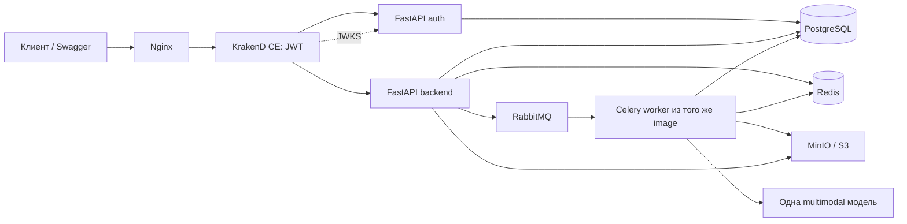

# ТЗ 3.0.0: проверяемая первая версия Science Extract за 12 часов

Дата: 20.11.2026. Этот файл полностью заменяет ТЗ 1.x–2.x. Он является единственной документацией будущего репозитория. Приложение реализуется в `science-extract/`; исходные материалы в `E:/RAG` остаются входными данными и не удаляются.

## 1. Цель, срок и ограничения

**GOAL-01.** Создать первую версию веб-сервиса извлечения научных данных из текстовых, сканированных и смешанных PDF. Сохранить функциональность обеих предметных областей, автоклассификацию, поиск, источники, ручные правки/историю, проверки, сравнения, CSV, JWT и автодеплой. Единственная отменённая пользовательская функция — выбор модели: используется одна модель из окружения.

**GOAL-02.** Целевое окно — 12 часов от текущего запроса, включая реализацию, исправления и человеческую приёмку. Ориентир начала по времени подготовки: 20.11.2026 около 22:01 МСК; окончания — 21.11.2026 около 10:01 МСК. Подготовка ТЗ тоже расходует это окно. Если новый чат запускается позже, считать оставшееся время до срока, а не начинать новые 12 часов. Это плановый бюджет, не гарантия скорости модели или отсутствия инфраструктурных проблем.

**GOAL-03.** Под «полностью проверена человеком» понимать прохождение всех функциональных сценариев раздела 12 на небольшом контрольном наборе с сохранённым результатом каждого шага. Научная полнота разметки всех 111 PDF, доказанный целевой F1 и проверка всех облачных моделей за это окно не заявляются. Ограничения исходных условий/эталона отмечаются, а не заменяются выдуманными числами.

**GOAL-04.** На момент запроса пользователь сообщил об остатке 87% пятичасового и 79% недельного лимита ChatGPT Plus. Эти проценты не переводятся в известное число токенов и не доказывают, что лимита хватит. Уменьшаем потребление коротким ТЗ, одной кодовой базой, одним provider, отсутствием повторной документации и небольшим тестовым набором. Не обещать точный расход/сброс лимита без данных интерфейса Usage. Расход зависит от модели, размера контекста, задачи и настроек: [официальное описание](https://learn.chatgpt.com/docs/pricing).

**GOAL-05.** Ключ API для обработки статей и доступ к целевому GitLab/серверу должны быть предоставлены заранее. Подписка для генерации кода и настроенные API-вызовы приложения — разные механизмы доступа; не предполагать, что вход в Codex автоматически даёт приложению API key. Без ключа нельзя принять реальное vision-извлечение; без сервера/runner нельзя принять фактический автодеплой. Реализацию остальных функций закончить, а неподтверждённую проверку обозначить blocked_external_configuration. Не выдавать mock за реальную модель.

## 2. Что упрощается, а что сохраняется

| Область | Решение первой версии |
|---|---|
| Прикладные сервисы | Два FastAPI-процесса: auth и backend. Четыре прежних контекста становятся auth и модулями documents/processing/catalog внутри backend. |
| Код и сборка | Одна кодовая база, один Dockerfile, один набор зависимостей, один app image для auth/backend/Celery worker. |
| Стек | Сохраняются FastAPI, Docker Compose, Redis, Celery, RabbitMQ, KrakenD CE, PostgreSQL, Nginx, MinIO/S3, SQLAlchemy, Alembic, Pydantic, GitLab CI/CD. |
| Clean Architecture | Тонкие routes → services → domain/ports; repositories и adapters реализуют порты. Один интерфейс на техническую возможность, а не на каждую таблицу/поле. |
| Предметное хранение | PostgreSQL JSONB: неизменяемый типизированный граф публикации на профиль/ревизию. Отношения внутри JSON проверяются схемой и правилами; технические данные — обычные ORM-таблицы. |
| Очереди | Одна рабочая очередь Celery и dead-letter; один worker concurrency=1. PostgreSQL хранит задания/outbox, Redis — кеш и временные Celery results. |
| Межсервисные вызовы | Только gateway → auth/backend и JWKS. Нет HTTP-вызовов между documents, processing и catalog: обычные вызовы application services в одной транзакционной границе. |
| Модель | Один реальный OpenAI Responses adapter; `MODEL_ID=gpt-6.1-terra` по умолчанию. Модель меняет оператор через env и перезапуск; каталога, probes, fallback и выбора через API нет. |
| Frontend | Только папка `frontend/` с `.gitkeep`. Swagger UI — инструмент ручной проверки API, самостоятельный frontend не реализуется. |
| Документация | Только этот файл. Без README, CHANGELOG, ADR, docs/, паспортов в исходном репозитории и генерируемых описаний на каждый модуль. Паспорта/отчёты экспорта — функциональные результаты приложения, а не документация репозитория. |

Не добавлять BFF, Kafka, Kubernetes, отдельные model/classifier/validation/export services, event bus поверх Celery, plugin framework, собственный DI-контейнер и многоуровневые generic repository factories. Функциональность реализовать прямыми сценариями, повторяющийся CRUD — общими обработчиками с закрытым entity_type и строгими DTO.

## 3. Архитектура и развёртывание



**ARCH-01.** Compose: nginx, krakend, auth, backend, worker, postgres, redis, rabbitmq, minio; один одноразовый init из того же image для миграции, ключей и admin. Auth/backend/worker используют общую библиотеку приложения, собственные команды запуска и один PostgreSQL database с логически выделенными auth/data таблицами. Общая БД — осознанное упрощение; внутри проекта не выдавать это за полную изоляцию микросервисных БД.

**ARCH-02.** Nginx — TLS, лимит загрузки, request_id, удаление входящих identity/gateway headers. Все `/api/v1/*` идут через KrakenD; `/docs` и `/openapi.json` доступны как API-документация backend, выполняемые из Swagger запросы используют публичные `/api/v1/*`. Auth OpenAPI можно открыть отдельно через `/auth-openapi.json`. Internal health/metrics не публиковать. Gateway no-op сохраняет multipart, JSON, PDF, PNG, ZIP, status и response headers; headers/query перечислить явно. Backend порты снаружи закрыты; dev-доступ при необходимости только localhost.

**ARCH-03.** Один initial Alembic revision создаёт все технические таблицы. Одна конфигурация Pydantic Settings, один SQLAlchemy sync engine/session factory на процесс, один MinIO adapter. CPU/OCR/LLM работают в worker, не в HTTP event loop. Синхронные route handlers допустимы; не вводить async ORM и мосты между event loops ради формы.

**ARCH-04.** Минимальные порты в одном ports.py: UnitOfWork/Repository, FileStorage, ModelClient, TaskPublisher, PasswordHasher/TokenIssuer. Services не импортируют FastAPI/SQLAlchemy/Celery/provider SDK. Pydantic DTO остаются schemas; domain rules работают с обычными структурами/Decimal. Реализации связываются простыми factories в main/worker. Не создавать интерфейс, DTO и factory для каждой мелкой функции.

**ARCH-05.** Авторский код вне models/, schemas/, repositories/, services/, routes/ начинается комментарием `# Назначение файла: ...` с перечнем реализованной функциональности. Shell/YAML/Dockerfile используют `#`; JSON комментарии не поддерживает, назначение описано здесь. Исходный checker организаторов не переписывать ради комментария: вызывать его через собственный wrapper.

## 4. JWT, роли и безопасность

**AUTH-01.** Auth сохраняет пользователей, Argon2id password hashes и hashed refresh sessions. Роли viewer/editor/admin. Первого admin создаёт init по ADMIN_EMAIL/ADMIN_PASSWORD из env/secret; известного пароля по умолчанию нет. Остальных создаёт admin API. Owner/editor изменяет свой корпус, viewer читает доступный ему собственный корпус, admin управляет всеми. Публичной регистрации нет; нельзя отключить последнего активного admin.

**AUTH-02.** Access RS256: sub, role, iss, aud, exp, iat, nbf, jti, kid. TTL 15 минут. Auth публикует JWKS только с public keys. Private key хранится mounted secret; init создаёт его однократно, не на каждом запуске. KrakenD действительно проверяет подпись, issuer/audience, срок и роль, передаёт sub/role как доверенные headers. Клиентские X-User-*/X-Token-*/gateway credential удаляются/перезаписываются, проверка spoofing обязательна. Gateway credential добавляется CE Martian request header из secret. Прямой пользовательский доступ к backend запрещён.

**AUTH-03.** Для JWKS production использовать mounted public JWK file или TLS к auth; в локальном private Compose допустим HTTP JWKS с явно dev-only настройкой. JWKS и health — read-only исключения из user authentication. Смена ключей поддерживается overlap public keys до exp старых токенов; простой административный subcommand, без отдельного key-management сервиса.

**AUTH-04.** Refresh — случайный 256-bit token, hash в БД, TTL 7 суток, ротация в транзакции. Reuse отзывает семью. Logout отзывает refresh family; logout-all и смена пароля — все семьи. Access остаётся до exp, мгновенный отзыв не обещать. Заблокированный пользователь не получает новых login/refresh. Токены в JSON, не URL; browser cookie/CSRF/BFF не добавлять без frontend. CORS по allowlist, по умолчанию same-origin.

**AUTH-05.** Корпус и вложенные объекты проверяются backend локально по owner_id, без сетевого ACL сервиса. Чужой объект и отсутствующий — 404; недостаточная роль при известном доступном объекте — 403. Redis rate limit login; при его отказе login fail-closed с 503, чтение научных данных может идти из PostgreSQL. Логи без паролей/токенов/provider secret; содержимое статьи не исполняется как команда.

## 5. Данные, версии и предметные профили

**DATA-01.** Обычные ORM-таблицы: users, refresh_sessions; corpora, documents, pages, artifacts; jobs, job_items, outbox; publications, publication_revisions, classification_revisions, issues, audit_entries. Идентификаторы UUID. В publications текущие revision pointers по profile; в publication_revisions immutable graph JSONB, profile, revision number, origin/run, author/reason. Технические FK/unique реализовать в БД; scientific links внутри графа проверять domain validator.

**DATA-02.** Граф содержит bibliography, scope decision, типизированные entity collections и evidence. Solar и RAG — разные Pydantic schemas, а не произвольный JSON. Каждый graph/record API валидирует всю затронутую схему; extra fields запрещены. Межпрофильные и межпубликационные ссылки недопустимы. Unknown — null в API, пустая CSV ячейка; ноль и false сохраняют собственный смысл, не подставляются вместо неизвестного.

**DATA-03.** PATCH/DELETE/activate требуют expected revision через If-Match. Нет precondition — 428, stale — 412. Правка копирует graph JSONB, меняет требуемый элемент, проверяет ссылки и атомарно создаёт revision/audit. Это одна общая функция, не набор версионных repositories на каждую entity. Нельзя удалить элемент с оставшимися ссылками. Перевод профиля в excluded создаёт пустой предметный граф, сохраняя прошлые версии; второй профиль статьи остаётся.

**DATA-04.** Первый машинный кандидат можно принять автоматически при уверенной классификации и отсутствии structural errors/ручных данных. Повторное извлечение создаёт candidate, не затирает ручные правки; доступно activate. Snapshot validation/export фиксирует в одной транзакции revisions графов и классификаций и сохраняет JSON в job input. После правки старый отчёт/ZIP остаётся прежним. Сложный diff/merge и отдельное distributed snapshot machinery не нужны.

**DATA-05.** publication_code равен исходному D001/P001, уникален в corpus; остальные CSV ids уникальны в publication/profile. При смешивании наборов с одинаковыми кодами нужен явный alias и manifest original_filename→code, не автоматическая тема по префиксу. Хранить исходный PDF/SHA-256. Один и тот же code+hash при повторной загрузке возвращает существующий документ; конфликт code/hash — 409.

**DATA-06.** Evidence хранится внутри version graph: field_path/entity_id, source page PDF с 1, section/table/figure, дословный fragment, bbox в PDF points (origin top-left), method text/table/ocr/vision/manual, confidence, review status и artifact ref. Для каждого результата источник обязателен; при значении из графика — crop/figure и способ чтения, без вымышленной цитаты. Raw value/unit сохраняются с цифрами, знаками и точностью; normalized — Decimal только при однозначном пересчёте. Диапазон/границу/приблизительность не превращать в точное число.

### Профиль solar-v1

Однопереходные экспериментально изготовленные тонкоплёночные приборы: perovskite, CIGS, CdTe, kesterite, Sb2Se3, thin-film Si. Тандемы и чисто расчётные статьи без образцов тематически могут быть solar, но in_scope=false. Сущности: material, device, layer, measurement, result. Measurement может ссылаться на несколько устройств. Прямой/обратный scan, champion/mean/median, условия и момент стабильности не объединяются. Для cited по соглашениям шаблона device_id/measurement_id пусты. Неизвестная aggregation — null.

Словари и точные поля брать из `Предметная область 1/submission_template/README.md` и CSV. Порядок слоёв от подложки, саму подложку в layers не включать; CdS buffer → ETL, metal grid → front_contact, другие промежуточные coatings → interlayer с исходным названием в note. Размерности: Eg eV; area cm2; thickness nm; PCE/FF/HI/stabilized_PCE/retained_PCE %; Voc V; Jsc/Jsc_EQE mA/cm2; Rs/Rsh Ohm*cm2; T80 h. Неизвестные единицы не угадывать.

### Профиль rag-v1

Система извлекает сведения из внешней коллекции и использует контекст при генерации; для in_scope=true нужны описание конфигурации и результаты оценки. Сущности: configuration, dataset, task, experiment, result. Configuration фиксирует retrieval/embedding/chunking/index/top_k/reranker/generator/context; версии и defaults не восстанавливать. Dataset/version/split не сливать. Result связан с config/dataset/task/experiment; top_k и metric_k различаются. Reproduced baseline — primary, число из другой статьи — cited. Названия метрик/задач/aggregation открытые, solar словари к ним не применять.

В `Предметная область 2` сейчас обнаружены копии solar checker/templates. Для RAG использовать предметные поля из корневого `E:/RAG/README.md` и PDF стр. 7–10; схему ниже маркировать project_defined_recommended, не официальной. Наличие RAG gold не предполагать.

## 6. Pipeline, классификация и фоновые задачи

**PIPE-01.** Принимать PDF до 100 MiB/300 страниц (env limits), проверять сигнатуру/читаемость/hash/шифрование. Не исполнять вложения/JavaScript. PyMuPDF — text/blocks/render/crops; pdfplumber — подходящие текстовые таблицы; Tesseract eng/rus — страницы/области без достаточного текста. Изображение на странице с текстовым слоем тоже должно обрабатываться: VLM получает релевантный page render/crop. PDF не изменять; файлы в приватном MinIO, не в broker/Redis/БД.

**PIPE-02.** Одна модель `gpt-6.1-terra` через Responses adapter, MODEL_ID и secret только из env. Один общий model call helper для классификации и extraction, со строгим output schema, timeout и ограниченными retry 429/5xx. Никаких нескольких providers, model registry/fallback/probes или dropdown. Из RAG-статей извлекаются их generator/embedding models независимо от runtime MODEL_ID. Не ждать, что OpenAI-compatible название означает поддержку нужного transport.

**PIPE-03.** Common stages: inspect → text/render/OCR → bibliography/classification/scope → profile extraction → linking/normalization → source/structural checks → candidate. Все страницы могут обрабатываться батчами, например по 3; не обрезать статью первыми страницами и не объявлять неполную обработку полной. Модель видит точные PDF page numbers. Сохранять промежуточный stage/page manifest, фактическую модель, schema/prompt versions, usage и coverage. Превышение бюджета/неполный JSON — явная ошибка/partial coverage, не успех.

**PIPE-04.** Классификация выполняется для каждого PDF по содержанию. Labels solar/rag/обе/пусто; outcome resolved/needs_review/outside/unreadable. Отдельно scope=true/false/null для каждого профиля и evidence. Расчётный solar paper или RAG survey не превращаются в outside только из-за scope=false. Не доверять имени файла/папке. Порог auto accept 0.85 — проектный стартовый score, не вероятность; требуется подтверждённое evidence и достаточное coverage. При недостаточности расширить чтение, затем needs_review; unreadable не равно outside.

**PIPE-05.** Для обеих тем отдельные profile graphs с общими page artifacts; вне области — bibliography/decision без subject records. needs_review ставит job в waiting_review. Ручной review создаёт новую classification revision с reason, затем job продолжает extraction без повторного OCR. Смена области не преобразует один graph в другой и не удаляет историю. Ручной classification review не перезаписывается reprocess без явного флага/причины. Standalone classify поддерживается kind=classify того же job API.

**PIPE-06.** Job kinds process/classify/validate/export. API возвращает 202. Одна очередь `work`, RabbitMQ durable/persistent и publisher confirms, JSON serializer; `dead_letter` для permanent failures. PostgreSQL — источник состояния. Job+outbox создаются одной транзакцией. Простой dispatcher loop запускается/останавливается lifespan единственного backend процесса в отдельном потоке, читает outbox с lease/skip_locked и публикует Celery tasks, не блокируя HTTP event loop. Он продолжает работу после восстановления брокера. Worker в своём процессе. Backend запускается с workers=1; горизонтальная масштабируемость сейчас не цель.

**PIPE-07.** at-least-once: task_id/job_item/stage keys уникальны; worker повторно проверяет состояние и не дублирует revision/import. Каждая успешная стадия фиксируется. Retry transient с backoff, максимум 3; permanent → failed + диагностическое сообщение DLQ. Один periodic шаг dispatcher восстанавливает истёкшие running leases; waiting_review не переисполняется. Отмена кооперативно между стадиями/страницами, без terminate как штатного механизма. Если успел завершиться provider call, сохранить промежуточный output, но не активировать отменённый run.

**PIPE-08.** Jobs states queued/running/waiting_review/succeeded/partially_succeeded/failed/cancel_requested/cancelled/blocked_external_configuration. Batch job агрегирует items; terminal retry создаёт новый job со ссылкой parent. Idempotency-Key на enqueue/validation/export, hash payload и unique constraint, повтор того же запроса возвращает прежний job, иной payload с ключом — 409. Broker outage даёт queued + dispatch_pending, не потерю задания. Redis cache outage допускает fallback чтения из PostgreSQL; jobs не восстанавливаются только из Celery result backend.

## 7. Проверки, поиск и экспорт

**CHECK-01.** Один validation service с явными функциями правил, а не rule engine/plugin framework. Проверять schema, ссылки, profile/version, duplicate cycles/self links, source page range, excluded graph, raw/normalized agreement, наличие evidence. Сопоставление цитат допускает Unicode/whitespace/перенос дефиса, но не удаление существенных цифр/знаков. Не найденное OCR совпадение — needs_review, визуальный указатель не объявляется текстово подтверждённым.

**CHECK-02.** Solar: `PCE_calc_% = 100 * Voc_V * Jsc_mA_cm2 * FF_fraction / Pin_mW_cm2`; при сопоставимых условиях отметить относительное расхождение >3%, знаменатель reported PCE>0 как проектное определение до полного регламента. Не подставлять отсутствующий Pin. Voc сравнить с Eg/q при достоверной связи; Jsc_EQE/Jsc_JV >5%, знаменатель abs(Jsc_JV)>0; champion vs mean только одна партия/условия. Противоречия между местами сохранять обеими записями. HI проверять только при известной формуле; отсутствующие официальные пределы Jsc/FF/PCE помечать awaiting_definition/skipped, не выдумывать.

**CHECK-03.** RAG: metric_scale, metric_k, normalization, protocol_mismatch, baseline_comparability, contradiction. Сравнимы task, dataset/version/split, definition/variant/scale/k и protocol. F1/ROUGE/BLEU по имени не определяют автоматически 0..1 или 0..100. Не распространять latency/tokens одной config на другие. top_k=0/metric_k=0 допустимы, page>0. Scientific issue хранит rule/version/severity/числа/источник/review, не удаляет исходное значение.

**CHECK-04.** Solar сравнение: материал, тип прибора, освещение AM1.5G/100 mW/cm2 по источнику, площадь и её определение, aggregation, scan direction, certification, stability/time. Неизвестная сопоставимость → причина needs_review; default area policy — точное совпадение, custom tolerance явно проектный. Общий comparisons handler выбирает profile policy; межпрофильного рейтинга нет.

**QUERY-01.** Поиск по metadata и сохранённому page text через PostgreSQL FTS/ILIKE, фильтры результатов по полям своего профиля, pagination max200. Для корпуса до 200 документов допустимо загрузить актуальные JSON graphs и отфильтровать records в одном application helper; не строить отдельный search/indexing service. Сортировка детерминированная, whitelist полей. Кеш Redis короткий, ключ включает corpus revision. Чужие корпуса исключаются до поиска.

**EXPORT-01.** kind=export фиксирует snapshot, worker создаёт ZIP в MinIO. Single profile — `submission/` с семью CSV + manifest.json, data_passport.json, validation_report.json. Mixed — раздельные solar-v1/rag-v1 каталоги и общий manifest. Результат содержит паспорт полей/типов/связей/единиц из общего profiles.py, не ручную вторую копию схемы. Библиография нужна для всех выбранных PDF, в том числе outside/not_target_domain/excluded; unknown не становится false. Strict export требует принятой классификации, активных in-scope graphs и отсутствия structural errors; allow_incomplete явно перечисляет пропуски. Научные warnings не блокируют экспорт.

**EXPORT-02.** UTF-8, comma, decimal dot, корректные quotes/newlines; null→пусто, bool→true/false, списки authors/record_ids/measurement.device_ids→`;`. metric_value/unit согласованы с normalized. Дубли имеют собственный id/source и duplicate_of; не путать с противоречием. PDF по умолчанию не включать; manifest содержит hashes/codes/revisions/model/pipeline/rules/coverage/UTC.

### Точные заголовки solar CSV

```text
publications.csv
publication_id,title,year,DOI,authors,in_scope,exclusion_reason
materials.csv
publication_id,material_id,material_name_raw,formula_normalized,material_class,dimensionality,additives,bandgap_value,bandgap_unit,bandgap_method,note
devices.csv
publication_id,device_id,absorber_material_id,device_label,device_role,device_type,architecture,substrate_type,active_area,area_unit,area_definition,encapsulation,note
layers.csv
publication_id,layer_id,device_id,layer_order,layer_function,layer_material,layer_thickness,thickness_unit,deposition_method,annealing_temperature,annealing_time,atmosphere,note
measurements.csv
publication_id,measurement_id,device_id,measurement_type,spectrum,light_intensity,intensity_unit,scan_direction,scan_rate,mask_used,certified,certification_lab,temperature,stability_protocol,stress_conditions,note
results.csv
publication_id,result_id,device_id,measurement_id,material_id,metric_name,metric_value,metric_unit,aggregation,spread_value,n_devices,time_point,time_unit,raw_value,raw_unit,normalized_value,normalized_unit,result_origin,cited_publication_id,source_page,source_section,source_table,source_figure,source_fragment,extraction_status,duplicate_of,note
issues.csv
publication_id,issue_id,record_ids,check_name,description,source_page,source_fragment
```

### Проектные рекомендуемые заголовки RAG CSV

```text
publications.csv
publication_id,title,year,DOI,authors,in_scope,exclusion_reason
configurations.csv
publication_id,config_id,rag_variant,retrieval_method,retriever_model,embedding_model,embedding_version,chunking_method,chunk_size,chunk_overlap,chunk_unit,index_type,vector_store,top_k,reranker_model,generator_model,generator_version,prompt_strategy,context_strategy,note
datasets.csv
publication_id,dataset_id,dataset_name,dataset_version,language,data_split,scientific_domain,note
tasks.csv
publication_id,task_id,task_type,note
experiments.csv
publication_id,experiment_id,evaluation_protocol,baseline_name,hardware,latency_ms,tokens_per_query,sample_size,note
results.csv
publication_id,result_id,experiment_id,config_id,dataset_id,task_id,metric_group,metric_name,metric_variant,metric_direction,metric_k,metric_value,metric_unit,baseline_value,aggregation,sample_size,raw_value,raw_unit,normalized_value,normalized_unit,result_origin,cited_publication_id,source_page,source_section,source_table,source_figure,source_fragment,extraction_status,duplicate_of,note
issues.csv
publication_id,issue_id,record_ids,check_name,description,source_page,source_fragment
```

**TOOLS-01.** В текущих исходниках requirements.txt не обнаружен. Checker в tools области 2 побайтово совпадает с solar checker области 1: SHA-256 `3E30DFCE04C67209A4AA9CA7BB0486A62D376C8650B33EC44D2C5C10C117C722`. Он проверяет часть структуры/словарей/ссылок и цитат через pypdf; не извлекает PDF, не делает OCR/physics/F1. Exit=1 для errors, иначе 0 даже при warnings; отсутствие PDF может быть пропущено. Новый source validator должен быть строже, чем удаляющая знаки/кириллицу normalization старого checker.

**TOOLS-02.** tools/requirements.txt — минимальные pinned Python dependencies автономного wrapper, для исходного checker достаточно pypdf; это не алгоритм извлечения. tools/check_submission.py нового проекта — свой wrapper с top comment, вызывающий известный исходный файл read-only через subprocess без shell=True и с timeout, сохраняя stdout/stderr/exit. Передавать solar CSV + соответствующие PDF. На RAG его не запускать: external_checker_status=not_available_for_profile, внутренние проверки выполнить. Eval CLI считает прозрачные dev P/R/F1 с one-to-one matching по publication/смысловым связям, не только случайным ids; это собственный evaluator, не официальный scorer. Отдельно классификация/scope и извлечение. Не использовать solar gold как RAG gold.

## 8. Полный план HTTP API

Prefix `/api/v1`, кроме явно указанного JWKS и health. Auth routes идут в auth, все остальные в backend. P — public; U — любой вошедший; V — viewer/editor/admin с ACL; E — editor-owner/admin; A — admin. Shared list response `{items,total,page,page_size}`. Errors `{error:{code,message,details,request_id}}`; gateway failures могут иметь минимальный body. Основные statuses 200/201/202/204, 401/403/404/409/412/413/415/422/428/429/503. Не генерировать десятки schema/route файлов на операции одной таблицы.

### Auth

| Метод и путь | Доступ | Назначение |
|---|---|---|
| POST `/auth/login` | P | Email/password → access/refresh/expires_in, общий 401 для неверных credentials. |
| POST `/auth/refresh` | P | Refresh → новая пара; rotation/reuse family policy. |
| POST `/auth/logout` | P + refresh | Отозвать семью refresh; повтор идемпотентен. |
| POST `/auth/logout-all` | U | Отозвать все refresh текущего пользователя. |
| GET `/auth/me` | U | Пользователь без secret/hash. |
| POST `/auth/change-password` | U | Проверить старый пароль, изменить и отозвать refresh. |
| GET `/users` | A | Список пользователей с pagination. |
| POST `/users` | A | Создать email/password/display_name/role. |
| GET `/users/{id}` | A | Карточка пользователя. |
| PATCH `/users/{id}` | A | Role/is_active/display_name, защита последнего admin. |
| GET `/.well-known/jwks.json` | P | Только открытые ключи, без `/api/v1`. |

### Корпуса, PDF и источники

| Метод и путь | Доступ | Назначение |
|---|---|---|
| GET, POST `/corpora` | U / E | Список доступных / создать name/description/split, classification_mode=auto. |
| GET, PATCH `/corpora/{id}` | V / E | Метаданные / изменить name/description; split неизменяем после загрузки. |
| POST `/corpora/{id}/archive` | E | Запретить новые изменения/запуски, сохранить чтение/историю. |
| GET, POST `/corpora/{id}/documents` | V / E | Список / multipart PDF+publication_code, inspect/hash/dedup. |
| GET, PATCH `/documents/{id}` | V / E | File metadata / изменить display_name/note, не PDF/code/hash. |
| GET `/documents/{id}/file` | V | Оригинальный PDF, binary response. |
| GET `/documents/{id}/pages` | V | Номера, размеры, readiness image/text по run. |
| GET `/documents/{id}/pages/{page}/image` | V | PNG страницы; 409 до render. |
| GET `/documents/{id}/pages/{page}/text` | V | Text/blocks/engine/OCR flag/coverage. |
| GET `/documents/{id}/artifacts` | V | Registered crops/tables/OCR artifacts, filters/page/run. |
| GET `/documents/{id}/artifacts/{artifact_id}/file` | V | Авторизованная выдача artifact, не arbitrary object key. |

### Processing, классификация, validation/export jobs

| Метод и путь | Доступ | Назначение |
|---|---|---|
| GET `/processing/configuration` | U | Одна model id, pipeline/rules versions, limits и configured flag; без secrets. |
| GET, POST `/corpora/{id}/jobs` | V / E | Список / enqueue kind process/classify/validate/export с document_ids или all_documents; target_profiles для проверки/экспорта. |
| GET `/jobs/{id}` | V | Status/counters/error/dispatch/coverage/revision snapshot и result refs. |
| GET `/jobs/{id}/items` | V | Item/stage/profile progress и ошибки по документам. |
| POST `/jobs/{id}/cancel` | E | Кооперативная отмена; terminal не переоткрывается. |
| POST `/jobs/{id}/retry` | E | Новый job по failed items; сохраняет parent, не затирает данные. |
| GET `/jobs/{id}/report` | V | JSON отчёт классификации/проверки/экспорта; 409 до готовности. |
| GET `/jobs/{id}/download` | V | ZIP export, Content-Disposition; 409 до ready, 410 после retention expiry. |
| GET `/jobs/{id}/passport` | V | JSON паспорт exported snapshot. |
| GET `/documents/{id}/classifications` | V | Текущая и исторические classification revisions с evidence/model. |
| POST `/documents/{id}/classifications/review` | E | expected_revision, labels/scope/reason → новая revision и продолжение waiting_review; нужен explicit flag для замены reviewed. |

Job create input: `{kind,document_ids?,all_documents?,target_profiles?,allow_incomplete:false,check_sources:true,run_external_checker:true,force:false}`. Неприменимые поля отвергать. Snapshot создаётся для validate/export, processing список фиксируется на enqueue; 202 содержит job_id/status_url. Idempotency-Key обязателен для безопасного повторения клиентом, при отсутствии допускается серверный новый UUID с возвратом значения. Выбор модели/URL/system prompt клиентом запрещён.

### Научный каталог и review

| Метод и путь | Доступ | Назначение |
|---|---|---|
| GET, POST `/corpora/{id}/publications` | V / E | Список / создать manual graph по document/profile и принятой classification. |
| GET, PATCH `/publications/{id}` | V / E | Bibliography/scope/profile pointers / metadata correction с новой revision. |
| GET, PUT `/publications/{id}/graph` | V / E | Прочитать version graph / заменить типизированный graph с If-Match и reason. |
| POST `/publications/{id}/exclude` | E | Новый excluded graph выбранного profile, причина обязательна. |
| GET `/publications/{id}/versions` | V | Candidates/current/history и summary. |
| POST `/publications/{id}/versions/{revision_id}/activate` | E | Structural check и атомарное переключение profile pointer с If-Match. |
| GET `/publications/{id}/audit` | V | Кто/когда/почему изменял graph/classification/review. |
| GET `/publications/{id}/evidence` | V | Sources с фильтром entity/field/page/review; версия по query. |
| POST `/publications/{id}/evidence` | E | Добавить source/field evidence, новая graph revision. |
| POST `/publications/{id}/evidence/{evidence_id}/review` | E | Confirm/reject с reason и сохранением исходного evidence. |
| GET, POST `/publications/{id}/entities/{entity_type}` | V / E | List/create конкретного typed entity, pagination, If-Match для create. |
| GET, PATCH, DELETE `/publications/{id}/entities/{entity_type}/{entity_id}` | V / E / E | Read/update/delete с проверкой схемы/ссылок и новой graph revision. |

Entity_type — закрытый allowlist material/device/layer/measurement/solar_result/configuration/dataset/task/experiment/rag_result. По значению выбирается конкретный Pydantic DTO, а не arbitrary dict/SQL. Profile явно задаётся query/body для общих graph/version операций; при единственном профиле может быть выведен. Ответ всегда содержит domain_profile, revision_id, ETag. Межпрофильное несоответствие — 409; unknown entity_type — 422. Полная замена graph и единичный CRUD вызывают один и тот же use case ревизии.

### Поиск, сравнения и замечания

| Метод и путь | Доступ | Назначение |
|---|---|---|
| GET `/corpora/{id}/results` | V | Flattened typed results, profile/metric/year/value/origin/issues и профильные фильтры. |
| GET `/corpora/{id}/search` | V | q + metadata/text/all + profile, page snippets, pagination. |
| POST `/corpora/{id}/comparisons` | V | Profile + result refs до 100 → группы сравнимости и причины исключения. |
| GET `/corpora/{id}/issues` | V | Rule/severity/profile/publication/review/run filters. |
| GET, PATCH `/issues/{id}` | V / E | Детали / review confirmed/dismissed/open с reason; научные числа не меняются. |
| GET `/corpora/{id}/review-items` | V | Единая очередь classification/scope/candidate/source/issues из общей БД. |
| GET `/domain-profiles` | U | Два профиля и версии схем. |
| GET `/domain-profiles/{profile}` | U | Fields/types/units/vocab/CSV schema и status official/recommended. |
| GET `/domain-profiles/{profile}/rules` | U | Правила, пороги/статус definition/applicability. |

У каждого HTTP-процесса `/health/live`, `/health/ready`, `/metrics` в private network; публичный Nginx `/health/live` означает только доступность ingress. Metrics — минимальные counters API/jobs/errors, логи — request/job/corpus IDs и timings. Worker health — CLI ping/heartbeat, не отдельный HTTP-сервер. Нет internal CRUD/import endpoints между scientific modules и нет model catalog API.

## 9. Компактная структура проекта

В приведённом дереве явно перечислен 61 файл, включая это ТЗ, тесты и Python init. Цель реализации — около 60–80 файлов с необходимыми уточнениями. Это ориентир, не причина объединять весь проект в main.py. Пустые __init__.py допустимы; не создавать параллельные schemas.py и schemas/.

```text
science-extract/                     # весь репозиторий приложения
├── TECHNICAL_SPECIFICATION.md       # единственная документация, копия этого ТЗ
├── .gitignore                      # secrets, inputs, weights, runtime outputs
├── .dockerignore                   # исключить corpus/gold/runtime/.git из build
├── .env.example                    # только названия и безопасные примеры
├── requirements.txt                # общий pinned набор для auth/backend/worker/tests
├── Dockerfile                      # один app image, OCR eng/rus и Python runtime
├── compose.yaml                    # все обязательные компоненты и одноразовый init
├── compose.production.yaml         # TLS/registry/digests/limits/secrets
├── .gitlab-ci.yml                  # один test/build/deploy pipeline
├── alembic.ini                     # одна схема миграций общего приложения
├── frontend/                       # будущий frontend, без UI/README/package.json
│   └── .gitkeep
├── app/                            # общая библиотека двух сервисов и worker
│   ├── __init__.py
│   ├── main.py                     # APP_MODE=auth/backend, routes и lifespan dispatcher
│   ├── config.py                   # настройки и limits
│   ├── domain.py                   # чистые типы, states, scientific invariants
│   ├── ports.py                    # компактные интерфейсы к внешним возможностям
│   ├── db.py                       # SQLAlchemy session/UoW lifecycle
│   ├── security.py                 # Argon2/JWT/JWKS/gateway credential implementations
│   ├── storage.py                  # единственный S3 adapter, checks hashes/access keys
│   ├── provider.py                 # один реальный Responses adapter
│   ├── profiles.py                 # две CSV schemas/vocabs/units и rule metadata
│   ├── worker.py                   # Celery task wrappers, dispatcher helpers, leases/retry
│   ├── models/                     # ORM только технических таблиц
│   │   ├── __init__.py
│   │   ├── auth.py                 # users/refresh sessions
│   │   └── data.py                 # corpus/files/jobs/revisions/issues/audit/outbox
│   ├── schemas/                    # строгие DTO, без бизнес-оркестрации
│   │   ├── __init__.py
│   │   ├── auth.py                 # login/refresh/user DTO
│   │   ├── graphs.py               # typed solar/RAG entities/graphs/evidence
│   │   └── requests.py             # jobs/query/review/common/error DTO
│   ├── repositories/               # SQL и mapping, без OCR/HTTP
│   │   ├── __init__.py
│   │   ├── auth.py                 # users/sessions transactions
│   │   └── data.py                 # graph versions/jobs/ACL/search/issue storage
│   ├── services/                   # прикладные сценарии через domain/ports
│   │   ├── __init__.py
│   │   ├── auth.py                 # login/refresh/logout/users
│   │   ├── pipeline.py             # OCR/classify/extract/link/review continuation
│   │   ├── catalog.py              # graph CRUD/versions/evidence/search/comparisons
│   │   ├── validation.py           # structural/source/solar/RAG rules
│   │   └── export.py               # snapshot → CSV/passport/report/ZIP/checker
│   └── routes/                     # тонкий FastAPI слой
│       ├── __init__.py
│       ├── auth.py                 # auth/user/JWKS routes, только auth process
│       ├── documents.py            # corpora/files/pages/artifacts и ACL dependencies
│       ├── jobs.py                 # единые jobs и classification review routes
│       ├── catalog.py              # graph/entity/query/review/profile endpoints
│       └── health.py               # live/ready/metrics
├── migrations/                     # общий Alembic environment
│   ├── env.py
│   └── versions/                   # первая версия без сложной migration истории
│       └── 0001_initial.py
├── infra/                          # готовая конфигурация обязательных компонентов
│   ├── nginx.conf                  # TLS/locations/limits/header stripping
│   ├── krakend.json.tmpl           # JWT/no-op/auth/backend routes и whitelist
│   └── rabbitmq.json               # durable work/DLX/dead_letter declarations
├── tools/                          # несколько прямых CLI, без документационных генераторов
│   ├── __init__.py
│   ├── manage.py                   # init/keys/import/evaluate/backup/restore/gateway render
│   ├── check_submission.py         # safe wrapper исходного solar checker
│   ├── requirements.txt            # pypdf для автономной технической проверки
│   ├── smoke.py                    # ingress E2E и JSON список результатов приёмки
│   └── deploy.sh                   # pull/migrate/up/wait/smoke/rollback app image
└── tests/                          # малый набор проверок реальных рисков
    ├── conftest.py                 # временная БД/clients/provider doubles
    ├── fixtures.py                 # синтетические PDF/scan/image graph и ожидаемые факты
    ├── test_auth.py                # password/refresh/reuse/roles
    ├── test_graphs.py              # оба graphs/units/links/revision/rules/CSV
    ├── test_pipeline.py            # classification/partial/source/idempotency/cancel
    └── test_integration.py         # DB/outbox/gateway/binary/export contract
```

Не создавать docs/, packages/, README*, CHANGELOG*, ADR*, отдельные YAML для каждой модели/правила или по файлу на endpoint. Prompts могут быть константами рядом с pipeline с явной версией; весь паспорт строится из profiles.py/DTO. Отчёты/файлы/ключи сохраняются в runtime volumes/MinIO и исключаются из Git; их количество не входит в размер исходного проекта. При разумной необходимости допустимы несколько дополнительных файлов, но не расширение архитектуры.

## 10. Конфигурация, запуск и GitLab

Окружение: APP_MODE, DATABASE_URL, RABBITMQ_URL, REDIS_URL, S3_ENDPOINT/BUCKET/ACCESS_KEY/SECRET_KEY, JWT_ISSUER/AUDIENCE/KEY_PATH, GATEWAY_SECRET, ADMIN_EMAIL/PASSWORD, OPENAI_API_KEY, MODEL_ID, MAX_PDF_BYTES/PAGES, MODEL_TIMEOUT, MAX_RETRIES, ALLOWED_ORIGINS, LOG_LEVEL, PUBLIC_BASE_URL. Секреты — env для dev и secret files/protected variables для production; не коммитить и не печатать rendered gateway config с secrets. Requirements/images закрепить после минимального compatibility smoke, не использовать latest в release.

```sh
# Создать .env из .env.example и заполнить значения самостоятельно.
docker compose build
docker compose run --rm init
docker compose up -d
docker compose exec backend python -m tools.smoke --base-url http://nginx --output /tmp/acceptance.json
docker compose exec backend pytest -q
# Единичный импорт вместо отдельной системы ingestion:
docker compose exec backend python -m tools.manage import --directory /inputs/dev --corpus CORPUS_UUID
```

Точные рабочие команды подстроить под Compose проекта в этом же ТЗ. Не создавать для них второй README. `/docs` должен иметь examples для login, multipart, job polling, full graph correction, validation/export job и скачивания. В Swagger явно обозначить scope/источники и statuses; это API-интерфейс приёмки, не готовый пользовательский frontend кейса.

**OPS-01.** GitLab pipeline test → build → deploy → smoke. Один app image tagged commit SHA для трёх ролей. Protected main автоматически разворачивает staging; protected v* tag — production. Registry GitLab, rootless BuildKit или уже доступный доверенный Docker runner — выбрать существующий рабочий вариант, не устанавливать новый кластер. resource_group предотвращает параллельные deploy. SSH known_hosts, deploy token через stdin, secrets на сервере; migrate один раз, compose up, readiness, ingress smoke. При неуспехе smoke вернуть прежний app image при обратно совместимой миграции; БД автоматически не downgrade.

**OPS-02.** Persistent PostgreSQL/RabbitMQ/Redis/MinIO volumes, только ingress 80/443 наружу. Daily PostgreSQL dump + согласованный backup объектов/manifest; простой manage backup/restore проверяет восстановление в пустую тестовую среду, не перезаписывает production по умолчанию. Не заявлять SLA/RTO/HA, нагрузочные benchmark и fault-tolerant cluster за 12 часов. Это эксплуатационные гарантии сверх проверяемых функций, а не основание удалить retry/историю/восстановление jobs.

## 11. План времени и экономии токенов

| Время от начала общего окна | Работа / контрольная точка |
|---|---|
| 0:00–0:30 | Проверить Docker/WSL, API key, входные примеры, runner/server и фиксированный срок; подготовка ТЗ входит сюда. |
| 0:30–2:00 | Один image/Compose, PostgreSQL migration, auth/JWKS, KrakenD/Nginx; сквозной login/role check. |
| 2:00–4:00 | PDF/S3/OCR, Celery/outbox, auto classification, два typed extraction profiles и source evidence. |
| 4:00–5:30 | JSONB revisions/CRUD/review, search/filter/compare, validation и CSV/export. |
| 5:30–6:30 | GitLab/deploy scripts, init/import/evaluate/backup commands, важные automated tests. |
| 6:30–8:00 | Запуск всего Compose, реальные model calls на контрольном наборе, исправление блокирующих ошибок. |
| 8:00–11:00 | Человек выполняет приёмку раздела 12; модель исправляет найденное, не начинает новые функции. |
| 11:00–12:00 | Резерв, повтор упавших сценариев и фиксация итогового статуса. |

Если контрольная точка не достигнута, сообщать фактическое отставание. Не сокращать научные поля, не заменять vision OCR-only и не объявлять непроверенное завершённым, чтобы попасть в срок. После 6:30 не добавлять новые абстракции/документацию; исправлять только сбои согласованных сценариев. Реальная выполнимость всех функций за оставшееся окно зависит от готовности окружения; при блокере явно назвать не прошедшую приёмку функцию.

Правила для генератора: один основной чат GPT-6.1 Sol с medium reasoning для обычной реализации, high только для конкретного сложного сбоя; без max по умолчанию и без параллельных агентов. Не перечитывать всё ТЗ/весь код после каждого изменения, читать нужный раздел/файл. Не печатать полные исходники в чат — писать в файлы. Один focused test после изменения, полный suite после значимого этапа. Не генерировать огромные gold fixtures, заглушечные сотни тестов, модельные benchmarks и четыре provider adapters. Ручной пользовательский контроль Usage при старте и после этапов; агент не утверждает, что знает оставшиеся проценты. Сохранять запас лимита для исправлений, не рассчитывать на неизвестное время reset.

## 12. Человеческая приёмка всех функций

Контрольный набор: один реальный короткий solar PDF с таблицей из dev; один RAG PDF с настоящим конфигурационным экспериментом (при его отсутствии — явно синтетический документ, не gold); scan одной известной страницы; mixed PDF с текстом и таблицей/рисунком-изображением; тематический, но out-of-scope документ; outside/ambiguous sample. Файлы/ожидаемые факты подготовить до дорогих model calls. Весь большой corpus не прогонять ради smoke. На изображениях человек проверяет хотя бы два числа, их единицы, подписи и страницу. Дополнительно независимая подборка двухтемного документа и нечитаемого файла может создаваться fixtures.py.

| № | Действие человека | Условие PASS |
|---|---|---|
| 1 | Поднять Compose и открыть /docs | Все обязательные технологии реально запущены, init/migration завершены. |
| 2 | Войти; проверить без JWT, expired/wrong token и spoofed X-User | Валидный проходит KrakenD, остальные отклонены; backend снаружи недоступен. |
| 3 | Создать editor/viewer, проверить refresh reuse/logout-all/password/block | Правильные роли, новая пара refresh, reuse/revocation без выдачи secret; access TTL объяснён. |
| 4 | Создать два корпуса разными пользователями | Чужой корпус 404, viewer не пишет, admin имеет ожидаемый доступ; archive запрещает новые изменения. |
| 5 | Загрузить PDF, повторить, затем неверный тип/слишком большой | Hash/dedup работает, конфликт/ошибка понятны, исходный PDF скачивается. |
| 6 | Запустить процесс и отдельно classify | 202/status polling/stage progress; имена папок не определяют тему. |
| 7 | Проверить solar/RAG/both/outside/ambiguous/unreadable | Области и scope различаются; unsure ждёт review, unreadable не становится outside. |
| 8 | Подтвердить/исправить классификацию | История/reason сохраняются, ожидающий run продолжается, предыдущие graphs не пропадают. |
| 9 | Обработать text/scan/mixed PDF | Реальный provider/OCR, таблица-изображение и график читаются; два проверенных значения связаны с нужными сущностями. |
| 10 | Открыть page image/text, crop, quote | Верная страница PDF/область, source match не теряет знаки, approximate reading помечено. |
| 11 | Изменить/добавить/удалить entity, попробовать stale revision и сломанную ссылку | Typed validation/If-Match; новая revision, не частичное повреждение graph. |
| 12 | Перезапустить extraction, activate/history/exclude/evidence review | Ручные данные не затёрты, старые версии доступны, scope=false пустой только в своём профиле. |
| 13 | Поиск, фильтры, pagination, comparisons двух профилей | Ожидаемые записи и причины несопоставимости, чужие данные не видны. |
| 14 | Validate заранее подготовленных нарушений solar и RAG | 3%/5% и scale/k/protocol/contradiction issues; неизвестные правила skipped с причиной, исходные числа сохранены. |
| 15 | Review issue и посмотреть audit/review queue | Автор/время/reason доступны, старый validation snapshot не переписан. |
| 16 | Export solar/RAG/mixed, затем изменить данные | Семь нужных CSV/профиль, пусто/0/false корректны, excluded coverage, паспорт/manifest; старый ZIP неизменен. |
| 17 | Запустить solar checker и dev evaluate на малом известном наборе | Логи/exit видны; RAG checker unavailable не выдаётся за passed; evaluator не считает случайные IDs смысловым совпадением. |
| 18 | Повторить enqueue с Idempotency-Key, отменить и retry | Нет дублей; отмена/новый retry job отражены, нет ложного success. |
| 19 | Остановить RabbitMQ/worker и восстановить | DB job/outbox сохраняются; после возврата обработка продолжается без повторных records. |
| 20 | Остановить Redis и проверить чтение/ограниченный login | Данные читаются из PostgreSQL, auth limiter даёт ожидаемый безопасный отказ, статус не теряется. |
| 21 | Проверить JSON logs/metrics и provider outage | IDs/timings/error code есть, secrets отсутствуют, нет fake извлечения. |
| 22 | Выполнить GitLab auto deploy и проверить release | Настоящий pipeline/build/deploy/smoke успешен; при отсутствии реквизитов только BLOCKED, не PASS. |
| 23 | Backup и restore в пустое тестовое окружение | Данные/objects согласованы, оригинальная среда не перезаписана. |
| 24 | Проверить репозиторий | Только одно ТЗ как документация; frontend пустой; нет corpus/gold/secrets/weights и сотен пустых файлов. |

tools/smoke.py записывает JSON `{scenario,status:pass/fail/blocked,evidence,error}` и помогает выполнить автоматизируемые пункты. Человек отдельно подтверждает научные/source пункты. Автотесты: auth/refresh/roles; graph links/revisions/units/rules/CSV обоих profiles; pipeline outcomes/idempotency; реальный DB/broker/gateway/binary roundtrip. В CI model double допустим, но пункт 9 требует реального API. Приёмка не завершена, пока есть FAIL или обязательный BLOCKED; нельзя обойти срок удалением строки чек-листа.

## 13. Источники и промпт нового чата

Источники read-only: `E:/RAG/ВИНИТИ+ЮФУ.pdf` (область 1 стр. 3–6, область 2 стр. 7–10, сдача стр. 11); `Предметная область 1/README_участникам.md`, `submission_template/`, `dev_gold/`, `tools/check_submission.py`; корневой `E:/RAG/README.md` о рекомендуемом RAG формате. dev содержит 21 статью D001–D022 без D011, test — 90 P001–P090. Полный регламент физических ограничений и настоящий RAG gold/checker отсутствуют в подтверждённых материалах. Все paths задавать env/mount, не встраивать Windows paths в код.

Технические основания: [KrakenD JWT/JWKS](https://www.krakend.io/docs/authorization/jwt-validation/), [no-op](https://www.krakend.io/docs/endpoints/no-op/), [Celery broker/backend](https://docs.celeryq.dev/en/stable/getting-started/backends-and-brokers/), [GitLab deployment safety](https://docs.gitlab.com/ci/environments/deployment_safety/), [выбранная модель](https://developers.openai.com/api/docs/models/gpt-6.1-terra). Доступность/совместимость закреплённых версий проверить один раз при старте, без длительного изучения альтернатив.

```text
Реализуй первую версию Science Extract строго по specification/TECHNICAL_SPECIFICATION.md v3.0.0.
Это единственное действующее ТЗ. Создай science-extract/, не изменяй исходные датасеты.
Сохрани весь функционал и стек, используй два FastAPI процесса и один image/кодовую базу.
Не возвращай архитектуру четырёх сервисов, model registry и сотни модулей.
Выбор модели отменён; один реальный Responses adapter, модель из env.
Соблюдай Clean Architecture и обязательные models/schemas/repositories/services/routes.
Документация в репозитории — только это ТЗ; frontend только .gitkeep.
Следуй временному плану, оставь минимум 3 часа на человеческую приёмку и 1 час резерва.
Не трать контекст на повторное чтение/вывод всего проекта и не запускай subagents.
Начни с проверки Docker/API credentials/runner/server; отсутствие доступа фиксируй как BLOCKED.
Реализуй все независимые части даже при внешнем блокере. Не подменяй модель/деплой заглушкой.
После этапа сообщай кратко: работает, проверено, осталось, блокеры; не создавай отдельный status.md.
Заверши реальным ingress smoke и чек-листом раздела 12, сохрани результаты JSON в runtime.
```
